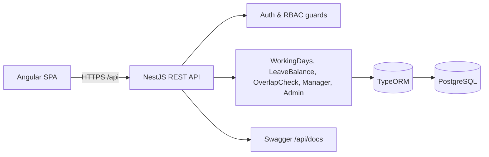
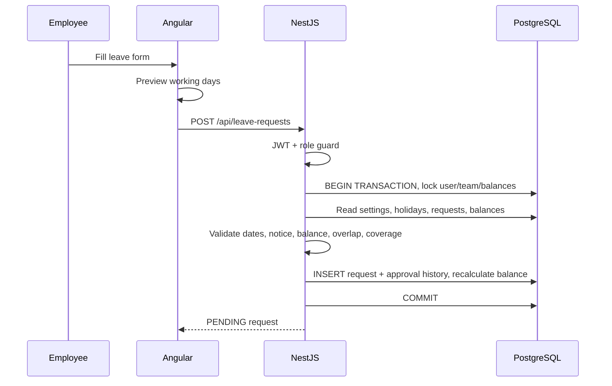
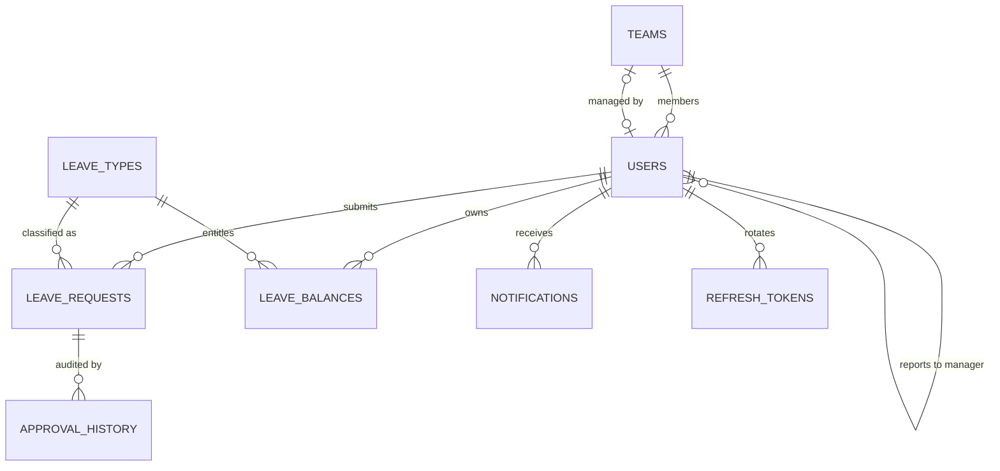

# Leave Management System

A production-quality, role-based Leave Management System built with Angular, NestJS, PostgreSQL and TypeORM. Employees submit and track leave requests, managers approve or reject requests from their own reports, and administrators configure all leave rules without code changes.

## 1. Project Overview

The system enforces the complete leave lifecycle:

- Working-day calculation that excludes weekends and configured public holidays.
- Available balance = yearly allowance − approved leave days − pending leave days.
- Overlap prevention for the same employee.
- Configurable team-coverage limits for every affected date.
- PENDING → APPROVED / REJECTED / CANCELLED workflow with a full audit trail.
- Strict server-side RBAC for exactly three roles: `EMPLOYEE`, `MANAGER`, `ADMIN`.
- JWT access tokens, rotating refresh tokens, bcrypt password hashing, rate limiting and CORS.

## 2. Features

### Employee
- Login/logout, personal dashboard, leave balance, apply leave, request history.
- Cancel eligible requests, team leave calendar, public holidays, profile.
- Cannot approve/reject, change configuration, or view other employees’ private records.

### Manager
- Manager dashboard, own reporting employees, pending approvals.
- Approve/reject only requests from own reports, with comments.
- Team leave history, employee balance summaries, availability, team calendar.

### Administrator
- Admin dashboard and system-wide statistics.
- Manage leave types and yearly allowances.
- Configure minimum notice days and maximum team members off per day.
- Manage public holidays and view teams/configuration.

## 3. Technology Stack

| Layer | Technology |
| --- | --- |
| Frontend | Angular 22 standalone components, TypeScript, Angular Router, Reactive Forms, HttpClient, SCSS, Chart.js |
| Backend | NestJS 11, TypeScript, REST, JWT, Passport, class-validator, Swagger/OpenAPI, Throttler |
| Database | PostgreSQL 16, TypeORM 0.3, migrations, constraints, indexes, transactions and row locks |
| Testing | Jest, Supertest, TypeScript unit/integration tests |
| Tooling | ESLint, Prettier, Docker Compose, npm scripts |

## 4. Architecture



Request flow for a leave application:



## 5. Folder Structure

```text
leave-management-system/
├── frontend/                         # Angular application
│   └── src/app/
│       ├── core/                     # Services, guards, interceptors, models
│       ├── features/                 # Login, dashboards, leave, calendar, admin pages
│       ├── layout/                   # Shell and landing layout
│       └── shared/                   # Reusable UI components and utilities
├── backend/                          # NestJS application
│   └── src/
│       ├── common/                   # Enums, decorators, guards, date utilities
│       ├── config/                   # Environment and database configuration
│       ├── database/                 # Entities, migration and seed
│       │   ├── entities/
│       │   ├── migrations/
│       │   └── seeds/
│       ├── modules/                  # Auth, users, leave requests, manager, admin, etc.
│       └── test/                     # Integration test fixtures and specs
├── database/                         # Database documentation and canonical-location notes
├── docs/                             # Architecture, API, database and demo docs
├── scripts/                          # Setup and verification helpers
├── docker-compose.yml
├── .env.example
├── .gitignore
├── package.json
├── PROJECT_PROGRESS.md
└── README.md
```

> The executable migration and seed TypeScript files live in `backend/src/database/` so that NestJS/TypeORM can import them directly. `database/` documents their location and purpose.

## 6. Database Schema

Required tables:

| Table | Purpose |
| --- | --- |
| `users` | Accounts with exactly one role; team and manager relationships |
| `teams` | Teams and their manager |
| `leave_types` | Name, description, yearly allowance, active flag, colour |
| `leave_requests` | Dates, working days, reason, status, decision metadata |
| `leave_balances` | Per user/type/year allowance snapshot and recalculated totals |
| `public_holidays` | Configured non-working weekday dates |
| `approval_history` | Complete action/actor/timestamp/comment audit trail |
| `system_settings` | Minimum notice and maximum team members off |
| `notifications` | User notifications for submission and decisions |
| `refresh_tokens` | Hashed, revocable refresh-token inventory |



All primary keys are UUIDs. Foreign keys are enforced, frequently queried columns are indexed, and `leave_requests` has checks for `end_date >= start_date` and `working_days > 0`. See `docs/database.md`.

## 7. Role and Permission Matrix

| Capability | Employee | Manager | Admin |
| --- | --- | --- | --- |
| Own dashboard | Yes | Yes | Yes |
| Apply/cancel own leave | Yes | Yes | Yes |
| View own balance/history | Yes | Yes | Yes |
| View team calendar (own team) | Yes | Yes | Yes |
| View own reports | — | Yes | — |
| Approve/reject own reports | — | Yes | — |
| Approve outside own reports | — | **No** | — |
| Leave type/settings/holiday configuration | — | — | Yes |
| System-wide statistics | — | — | Yes |
| Change own role | — | — | — |

Frontend guards only improve navigation. Every protected operation is independently enforced by NestJS guards and service/database queries.

## 8. Installation and Startup

### Prerequisites

- Node.js 20+ (22+ recommended), npm 10+
- Docker and Docker Compose (recommended for PostgreSQL)
- Alternatively, a local PostgreSQL 16 instance

### Quick start with Docker

```bash
cp .env.example .env
# Edit JWT secrets in .env
npm run setup
docker compose up -d postgres
npm run migration:run
npm run seed
npm run dev
```

- Frontend: <http://localhost:4200>
- Backend API: <http://localhost:3000/api>
- Swagger: <http://localhost:3000/api/docs>

This starts PostgreSQL in Docker and runs the API/Angular dev servers on the host. To run the backend in its container instead, apply migrations and seed first, then use `docker compose up -d` (do not run `npm run dev` at the same time, or port 3000 will conflict).

### Local development without Docker

1. Start PostgreSQL and create the database/user from `.env`.
2. Run `npm run setup`.
3. Run `npm run migration:run`.
4. Run `npm run seed`.
5. Run `npm run dev` in two terminals, or `npm-run-all --parallel dev:backend dev:frontend`.

For backend-only smoke testing without PostgreSQL, set `DB_TYPE=sqljs`. This uses an in-memory database and is intended for tests, not persistence.

## 9. Environment Configuration

Copy `.env.example` to `.env`. Important values:

| Variable | Purpose | Default |
| --- | --- | --- |
| `DB_TYPE` | `postgres` or `sqljs` | `postgres` |
| `DB_HOST`, `DB_PORT`, `DB_USERNAME`, `DB_PASSWORD`, `DB_NAME` | PostgreSQL connection | Docker Compose values |
| `JWT_ACCESS_SECRET` | Access-token signing secret | Must be replaced |
| `JWT_REFRESH_SECRET` | Refresh-token signing secret | Must be replaced |
| `JWT_ACCESS_TTL`, `JWT_REFRESH_TTL` | Token lifetimes | `15m`, `7d` |
| `BCRYPT_ROUNDS` | Password hashing cost | `12` |
| `PORT`, `API_PREFIX`, `FRONTEND_URL` | Server and CORS | `3000`, `api`, `http://localhost:4200` |
| `AUTH_RATE_LIMIT` | Login/refresh requests per minute | `5` |

Never commit `.env` or real secrets.

## 10. Database Commands

```bash
npm run migration:run      # Apply InitialMigration
npm run migration:revert   # Revert the latest migration
npm run seed               # Reset and populate realistic demo data
```

The seed is idempotent: it deletes existing demo rows and recreates a known, logically consistent dataset. It creates 1 admin, 2 managers, 8 employees, 3 leave types, public holidays and 40 leave requests across all four statuses.

## 11. Development and Build Commands

```bash
npm run dev                # Backend watch mode + Angular dev server
npm run dev:backend
npm run dev:frontend
npm run build              # Production builds for both apps
npm run build:backend
npm run build:frontend
npm test                   # Backend Jest/Supertest suite
npm run test:frontend      # Angular unit tests
npm run lint
npm run format
```

## 12. Automated Tests

The backend suite contains 40 passing tests covering authentication, RBAC, ownership checks, manager boundaries, working-day calculation, holiday exclusion, balance semantics, overlap, team coverage, notice validation, cancellation, invalid transitions, configuration changes, calendar authorization, approval-time re-validation, year-crossing balances and refresh-token rotation/replay detection.

```bash
npm test
```

Tests use an isolated in-memory SQL.js database, so no external PostgreSQL instance is required.

## 13. Demo Credentials

All seeded users share the password:

```text
Demo@12345
```

| Role | Email |
| --- | --- |
| Admin | `admin@leave.com` |
| Manager | `manager1@leave.com` |
| Manager | `manager2@leave.com` |
| Employee | `employee1@leave.com` … `employee8@leave.com` |

## 14. API Documentation

Swagger UI is available at <http://localhost:3000/api/docs> when the backend is running. The OpenAPI JSON is served at `/api/docs-json`.

Main endpoints:

```text
POST   /api/auth/login | refresh | logout
GET    /api/auth/me
GET    /api/users/me | /me/balance | /me/requests
POST   /api/leave-requests
GET    /api/leave-requests | /:id
POST   /api/leave-requests/:id/cancel
GET    /api/manager/team | /pending-requests | /team-history | /availability
POST   /api/manager/requests/:id/approve | /:id/reject
GET    /api/calendar
GET    /api/leave-types
GET    /api/admin/settings | /leave-types | /holidays | /statistics | /teams
PUT    /api/admin/settings | /leave-types/:id
POST   /api/admin/leave-types | /admin/holidays
DELETE /api/admin/holidays/:id
```

## 15. Business Rules

- **Working days:** Saturdays, Sundays and configured public holidays are excluded. Holidays on weekends never double-count.
- **Balance:** `available = allowance − approved − pending`. Pending reserves days; approved consumes them; rejected/cancelled consume nothing. The same request is counted once.
- **Calendar year:** A request spanning New Year is split between both years by counting only the working dates that fall in each year. Allowance changes apply to the current and future years; past years retain their snapshot.
- **Approval-time validation:** Coverage, overlap, started-date and allowance rules are re-checked when a manager approves, so an admin configuration change made after submission is still enforced.
- **Unpaid leave:** Configurable allowance (seeded as 5 days) and the same validation policy; it is never assumed unlimited.
- **Overlap:** PENDING and APPROVED requests from one employee cannot overlap. Rejected/cancelled requests do not block.
- **Coverage:** For every affected working date, other PENDING/APPROVED team members must be fewer than the configured maximum. The requester is excluded.
- **Concurrency:** PostgreSQL uses `SELECT … FOR UPDATE` locks on the employee, team and balance rows inside transactions. SQLite tests rely on single-writer serialization.

## 16. Troubleshooting

| Problem | Fix |
| --- | --- |
| `ECONNREFUSED 5432` | Start Docker Compose or PostgreSQL, then re-run migration |
| `password authentication failed` | Verify `.env` matches `docker-compose.yml` |
| Frontend shows login but APIs fail | Confirm backend is on port 3000 and CORS `FRONTEND_URL` matches |
| 401 after login | Access token expired; the interceptor refreshes automatically; otherwise log in again |
| 403 on manager actions | Request belongs to a different manager’s report; this is intentional |
| Seed fails with duplicate key | Re-run `npm run seed`; it resets demo data |
| Port already in use | Stop the existing process or change `PORT`/Angular port |
| Angular build cache issues | Delete `frontend/.angular` and rebuild |
| `npm` install-script warnings | Run `npm install-scripts approve esbuild @parcel/watcher` if a native build is required |

## 17. Five-Minute Demo Recording Checklist

1. **0:00–0:30** — Show login page; log in as `admin@leave.com`.
2. **0:30–1:15** — Admin dashboard: statistics, leave types, settings and holidays. Change minimum notice to 2 and save.
3. **1:15–1:45** — Log out; log in as `employee1@leave.com`.
4. **1:45–2:45** — Employee dashboard and balance chart; apply leave with a weekend in the range and show calculated working days; submit.
5. **2:45–3:15** — My Requests: show PENDING status and attempt an invalid overlapping request.
6. **3:15–4:15** — Log out; log in as `manager1@leave.com`; show own reports and pending approvals; approve one request with a comment.
7. **4:15–4:40** — Team calendar showing approved/pending/holiday indicators and availability.
8. **4:40–5:00** — Swagger docs and README; mention 40 passing automated tests.

## 18. Remaining Limitations

- No public registration/onboarding by design; accounts are created by administrators or seed data.
- Email/SMS delivery is represented by persisted notifications; no external mail provider is configured.
- The frontend automatically attempts one refresh-token rotation on a 401 before redirecting to login.
- The Docker Compose backend uses development JWT secrets unless `JWT_*` variables are exported; replace them for real deployments.

## 19. Final Status

Implementation status, verification commands and results are tracked in `PROJECT_PROGRESS.md`.
